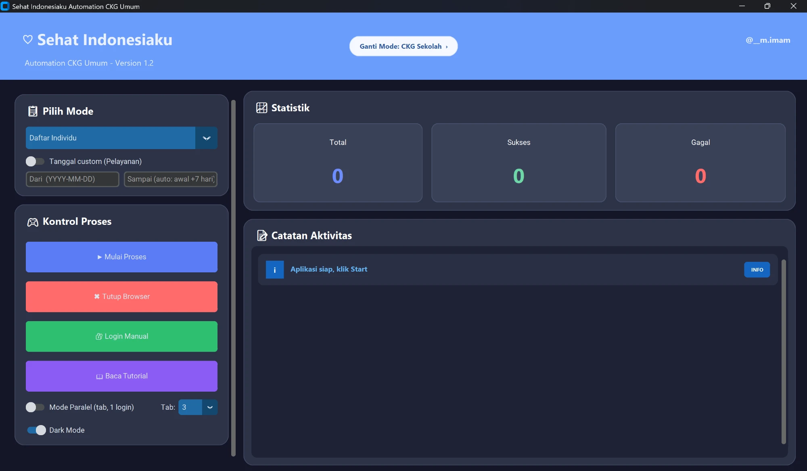
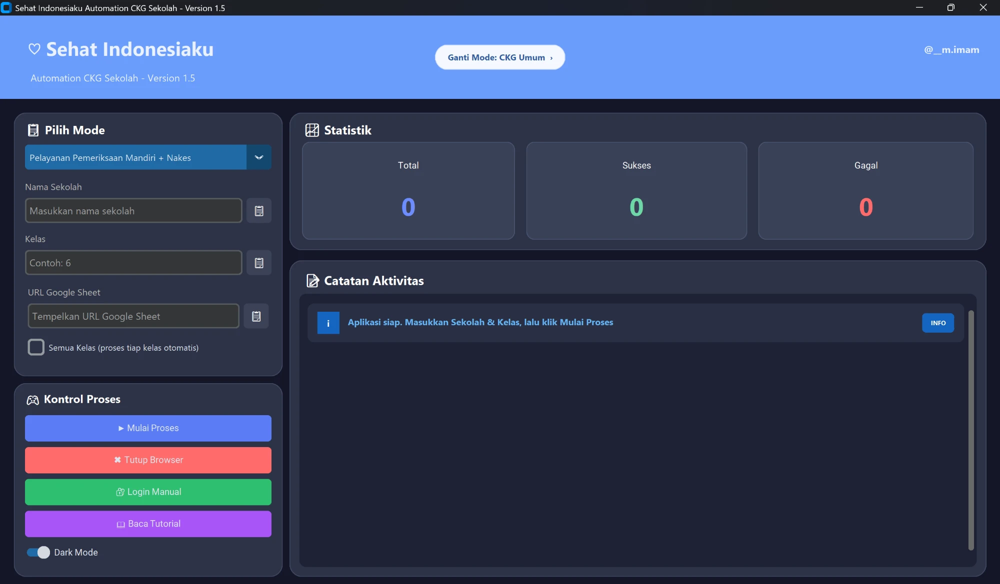

# Panduan Sehat Indonesiaku

## Download aplikasi

Unduh aplikasi melalui link berikut:

[Download SEHATINDONESIAKU.exe](https://drive.google.com/file/d/16AWyM91kU32VrS99Ib94HRd9XaZl5NbT/view?usp=sharing)

## Tampilan aplikasi

**CKG Umum**



**CKG Sekolah**



## File yang harus ada

Letakkan empat file berikut dalam satu folder:

```text
SEHATINDONESIAKU.exe
akun.json
asik.json
Laporan Kunjungan Pasien.xlsx
```

Komputer pengguna tidak perlu menginstal Python, module Python, Playwright, `ckg all.py`, atau `run.bat`.

## Pengaturan akun

Buka `akun.json` menggunakan Notepad, lalu isi:

```json
{
    "email": "email-anda@example.com",
    "password": "password-anda"
}
```

Simpan menggunakan format JSON yang valid. Jangan membagikan file ini karena berisi password.

## Menjalankan aplikasi

1. Pastikan empat file wajib berada dalam satu folder.
2. Klik dua kali `SEHATINDONESIAKU.exe`.
3. Aplikasi akan membuka CKG Umum secara default.
4. Gunakan tombol **Ganti Mode** untuk berpindah ke CKG Sekolah.

## Login pertama kali

1. Klik **Login Manual**.
2. Tunggu Google Chrome atau Microsoft Edge terbuka.
3. Login menggunakan akun pada `akun.json`.
4. Ikuti instruksi yang muncul sampai proses selesai.
5. Aplikasi menyimpan sesi login ke `asik.json`.

Jika token atau sesi kadaluarsa, klik **Login Manual** kembali.

## Browser

Aplikasi menggunakan Google Chrome atau Microsoft Edge yang sudah terpasang di komputer. Pengguna tidak perlu menjalankan `playwright install`.

Jika browser gagal dibuka, pastikan Chrome atau Edge sudah terpasang, kemudian jalankan kembali aplikasi.

## CKG Umum

### Daftar Individu

1. Pastikan `Laporan Kunjungan Pasien.xlsx` berada dalam folder aplikasi.
2. Pilih mode **Daftar Individu**.
3. Klik **Mulai Proses**.

### Konfirmasi Kehadiran

1. Pilih mode **Konfirmasi Kehadiran**.
2. Atur tanggal jika diperlukan.
3. Klik **Mulai Proses**.

### Pelayanan

1. Pilih mode **Pelayanan**.
2. Pilih tanggal custom jika diperlukan.
3. Aktifkan mode paralel jika diperlukan.
4. Klik **Mulai Proses**.

## CKG Sekolah

### Pelayanan Pemeriksaan Mandiri + Nakes

1. Isi **Nama Sekolah**.
2. Isi **Kelas**, atau centang **Semua Kelas**.
3. Isi URL Google Sheet.
4. Pastikan Google Sheet dapat diakses oleh siapa saja yang memiliki link.
5. Klik **Mulai Proses**.

### Konfirmasi Individu

1. Isi **Nama Sekolah**.
2. Isi **Kelas**, atau centang **Semua Kelas**.
3. Atur tanggal jika diperlukan.
4. Klik **Mulai Proses**.

### Daftar Baru Individu

1. Isi **Nama Sekolah**.
2. Isi URL Google Sheet.
3. Pastikan format kolom sheet sesuai kebutuhan aplikasi.
4. Klik **Mulai Proses**.

## Google Sheet

- Akses sheet harus diatur menjadi **Anyone with the link / Siapa saja yang memiliki link**.
- Gunakan akses **Viewer/Pembaca**.
- Untuk sheet tertentu, gunakan URL lengkap yang memiliki parameter `gid`.
- Jangan mengubah nama kolom atau struktur data tanpa menyesuaikannya dengan aplikasi.

## File data

- `akun.json`: email dan password untuk login manual.
- `asik.json`: cookies atau sesi login yang disimpan aplikasi.
- `Laporan Kunjungan Pasien.xlsx`: data pasien untuk CKG Umum.
- `SEHATINDONESIAKU.exe`: aplikasi utama.

## Masalah umum

### File tidak terbaca

Pastikan nama file benar dan semua file berada satu folder dengan EXE.

### `asik.json` tidak ditemukan

Klik **Login Manual** untuk membuat atau memperbarui sesi login.

### Chrome atau Edge tidak ditemukan

Install Google Chrome atau Microsoft Edge, lalu buka kembali aplikasi.

### Aplikasi berhenti

Jalankan ulang `SEHATINDONESIAKU.exe`. Jangan menutup aplikasi ketika proses browser masih berjalan.

## Keamanan

- Jangan membagikan `akun.json` atau `asik.json`.
- Jangan mengunggah kedua file tersebut ke GitHub atau penyimpanan publik.
- Gunakan aplikasi hanya pada komputer yang dipercaya.
